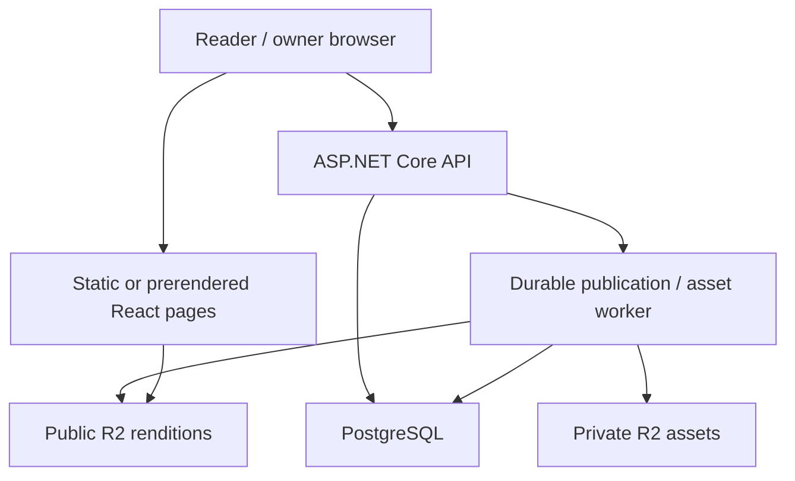

# Architecture

> **Backend implementation update · 8 October 2026:** Express 5 + TypeScript, Neon PostgreSQL, Cloudflare R2 and Zod replace the earlier ASP.NET proposal. See [current implementation and contracts](10-backend-implementation.md)
## Implemented frontend

React 19 + TypeScript, Vite, Tailwind 4, local shadcn/ui components, Motion, and UI SFX. React Router owns `/`, `/posts`, `/posts/:slug`, and the fallback page. TanStack Query handles loading, caching, retry, cancellation and pagination. Zod checks incoming content at the repository boundary.

```text
src/data/portfolio.ts              Personal content and uploaded headshot path
src/features/writing/contracts.ts Runtime schemas and repository interface
src/features/writing/repository.ts JSON and HTTP implementations
src/features/writing/queries.ts    Query keys and cache hooks
src/features/writing/post-list.tsx Shared list, recent entries and states
src/features/writing/markdown.tsx  Safe Markdown and stable heading IDs
src/features/writing/pages.tsx     Archive, article and not-found routes
src/components/layout/            Theme/sound shell, metadata, error boundary
src/data/posts.json         Bundled, versioned sample fixture (no fetch)
public/images/headshot.png        User-provided original image
scripts/build-content.mjs         Static entry points, RSS and sitemap
```

Components consume query hooks; hooks consume `ContentRepository`; adapters return the same domain shape. UI components do not fetch directly or inspect fixture structure. The profile is still a static module; the future profile endpoint is specified but not connected. There is no administrative UI in this release.

`VITE_CONTENT_SOURCE=json` is the default. `api` selects `HttpContentRepository` using `VITE_API_BASE_URL` (default `/api/v1`). Values are build-time public configuration. The JSON adapter validates an imported local file and makes no network request. The HTTP client uses `credentials: omit` for public reads. A future admin client must be separate and use same-origin session credentials plus CSRF protection. Never put API secrets or R2 credentials in `VITE_*` variables.

Query cache: 60-second freshness, 5-minute garbage collection, no refetch on window focus, one retry for 5xx/network failures, no retry for 4xx, 10-second network timeout, navigation cancellation passed to fetch. JSON cursors are fixture IDs; consumers treat them as opaque. Production cursors are signed server tokens and are intentionally not interchangeable with fixture cursors.

## Rendering and metadata boundary

The current site is a client-rendered Vite SPA. The build creates `/posts/index.html` and one metadata-bearing entry point for each fixture slug; these do not contain a rendered article body. Client metadata updates on navigation. A generated `404.html` is provided, but the static host controls response status and unknown-route fallback. Browser back/forward uses React Router; route changes focus main and scroll to top unless an anchor is present.

Future production publishing needs either server rendering or a reliable prerender/rebuild step for public pages. Recommended v1: keep the static frontend build and add a deterministic public-content snapshot/prerender job after successful publication, with a fallback that serves the last successful build. Serve proper 404s for removed slugs. An API-backed dynamic page by itself is not completion of the SEO gate. In API mode this preview build intentionally does not generate fixture article shells or feed entries.

## Target service

Use an ASP.NET Core 10 LTS modular monolith, PostgreSQL with EF Core/Npgsql, and a small durable background worker in the same deployable solution. Modules: Profile, Publishing, Assets, Identity, Operations. This keeps transactions local and avoids unnecessary independent services for a single-owner portfolio. The process needs a host that supports .NET and outbound PostgreSQL/S3 connections. The current Sites static host is not a .NET runtime; deploy the API separately and put a same-origin gateway/proxy in front of `/api/v1`.



The owner browser receives a narrowly scoped presigned PUT URL from the API and uploads directly to private R2. This is the only direct write from the browser to object storage. Public images use a custom asset domain; private preview uses an authenticated route that temporarily signs one ready rendition. R2 never stores the authoritative article body or publication state.

## Persistence model

| Table | Essential columns / invariants |
| --- | --- |
| `profiles` | Singleton id, version, display_name, role, introduction, email, location nullable, avatar_asset_id nullable, social_links jsonb, sections jsonb, updated_at. Sections cover work/projects/education/skills/interests. |
| `posts` | UUID id, unique normalized slug, lifecycle (`draft`,`published`,`unpublished`,`archived`), version int, draft_revision_id, published_revision_id nullable, first_published_at nullable, created_at, updated_at, archived_at nullable. Published slugs are immutable in v1. |
| `post_revisions` | UUID id, post_id, revision_number, title, excerpt, body_markdown, tags jsonb, cover_asset_id nullable, created_at, created_by. Immutable rows; unique(post_id, revision_number). |
| `revision_assets` | revision_id, asset_id, alt, caption, sort_order; FK checks and unique pair; preserves article-specific alt/caption. |
| `assets` | UUID id, state, reserved_object_key, file_name for display, declared_type/size, actual_type/size/hash, width/height, created_by, version, created_at, expires_at, rejection_code nullable. No public original URL. |
| `asset_variants` | asset_id, variant, private_key, public_key nullable, mime, width, height, bytes, sha256. Unique(asset_id, variant). Immutable keys include hash. |
| `operations` | UUID id, kind, resource_id, requested_revision_id nullable, status, progress, result jsonb nullable, error jsonb nullable, requested_by, timestamps. |
| `outbox` | UUID id, operation_id, kind, payload, attempts, available_at, lease_until, last_error. Written in the same DB transaction as the initiating state change. |
| `idempotency_keys` | admin_subject, method, path, key, request_hash, response_status, response_body, expires_at. Unique(subject,method,path,key). Retain 24 hours. |
| `audit_events` | actor subject, action, target id, revision id nullable, trace_id, timestamp. Do not log tokens, signed URLs, or complete article drafts. |

Index public reads on first_published_at DESC, id DESC where lifecycle=published; index operation status/available time and asset expiration. Use DB constraints in addition to request validation. Store UTC instants, retain UUID identity, and generate versions in the database. Every public title/body/tag/image is resolved through `published_revision_id`, never `draft_revision_id`.

## Publication state and consistency

Create draft → save immutable revision → upload/process referenced assets → request publish of exact revision → worker copies clean renditions to immutable public keys → transaction advances published pointer and lifecycle → cache/feed/prerender invalidation is retried from outbox.

An edit during publication creates a newer draft but does not alter the revision captured by the operation. The worker uses a per-post operation lock; publishing/unpublishing another revision concurrently returns 409. It must not overwrite the latest draft pointer when committing publication. One article is atomically visible at the database boundary; R2 copies are prepared first. No cross-provider distributed transaction is assumed.

If copying fails, the previous published revision remains public and the operation fails or retries. If DB commit fails after copying, the public orphan is harmless but must be garbage-collected after a grace period. An unpublish operation removes the public DB pointer/lifecycle first, then invalidates caches and rebuilds routes. The operation completes only when required invalidations succeed. A cached copy or downloaded image cannot be retroactively revoked; avoid publishing confidential material.

Assets can be deleted only if no retained revision/profile references them and no operation is using them. Archived posts retain revision history by default. A separate, explicit future retention policy may remove old revisions; do not silently delete them as part of normal editing.

## Security and failure boundaries

- Owner identity is a verified OIDC subject allowlist; session cookies Secure, HttpOnly, SameSite=Lax and path-scoped appropriately. Validate CSRF on all state-changing admin requests and validate Origin/Referer. OIDC uses state, nonce and PKCE.
- No raw HTML or executable MDX. ReactMarkdown skips HTML and applies safe URI handling. The renderer only displays images declared in the validated media list; server publication must constrain those URLs to the configured asset domain.
- Render errors are caught by a root error boundary; query errors stay local with retry. There is no local draft in the public bundle.
- Public API may be cached; authenticated content is `Cache-Control: private, no-store`, varies appropriately, and must never enter the public CDN cache.
- Use structured logs, request/operation IDs, redaction, a durable job lease with bounded retries, and a dead-letter state visible to the owner.

## Architectural decisions

| Decision | Reason / tradeoff |
| --- | --- |
| JSON behind a repository first | Fast preview while fixing contract boundaries; large fixtures put all bodies in the JavaScript bundle and are unsuitable for production scale. |
| Markdown, not executable MDX | Portable stored content with a smaller execution/security surface. |
| Immutable revisions | Draft isolation and reliable publication at the cost of extra rows. |
| R2 private/public separation | Draft originals never leak through the public asset domain; publication requires copying and cleanup. |
| Async processing + outbox | Survives process restarts and partial R2 failures without requiring a separate queue service initially. |
| Static/prerender frontend + .NET API | Preserves current implementation and .NET familiarity; requires a gateway and publication-triggered content build. |
| Single owner, no reader accounts | Keeps product and authentication scope small. |

## Portfolio chat module

The shared SiteLayout mounts the CRT launcher across routes. `usePortfolioChat` owns an in-memory anonymous session and request lifecycle; `ChatClient` has local Demo and HTTP/SSE implementations selected by `VITE_CHAT_SOURCE`. The demo makes no network requests. API mode loads backend configuration, creates a session only on first send, streams one answer at a time, and deletes the session when starting over. Closing aborts generation; history remains in memory until reset/refresh. Plain-text messages avoid executable Markdown/HTML.

The future .NET Chat module reads approved public profile/post revisions, maintains versioned knowledge documents, invokes a server-side IChatClient provider boundary, and streams a validated application-owned SSE protocol. It has no action tools. Publication outbox events refresh its knowledge snapshot; authoritative visibility checks also run at retrieval/finalization to prevent stale unpublished content. Anonymous ChatSessionToken capabilities and owner OIDC sessions are separate security domains. See `09-ai-chat-requirements.md` for schema, endpoint, retry, privacy and budget details.
